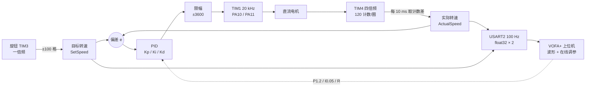

# STM32 直流电机速度闭环控制

STM32F103C8T6 + 增量式编码器 + PWM 驱动 H 桥，实现 **10 ms 周期（100 Hz）的电机速度闭环**。
旋钮给目标转速，串口把「目标 / 实际」两路数据实时发给上位机画曲线，**PID 三个参数可以在线上改，不用重新烧录**。

> 这是我大一时从零搭起来的第一个闭环项目。逻辑不复杂，但每一处设计都有具体原因，
> 第 7 节如实列出了它目前已知的缺陷。

---

## 0. 我写的代码在哪

HAL 库和 CubeMX 生成的模板占了大部分体积，真正手写的只有这几个文件：

| 文件 | 作用 | 行数 |
|---|---|---|
| `Core/Src/PID.c` / `Core/Inc/PID.h` | PID 算法、限幅、抗饱和、串口在线调参 | 127 / 27 |
| `Core/Src/VOFA.c` / `Core/Inc/VOFA.h` | 编码器计数 → 转速换算 | 20 / 10 |
| `Core/Src/encoder_xuanniu.c` | 旋钮增量累计 → 目标转速 | 23 |
| `Core/Src/main.c`（`while` 循环段） | 10 ms 节拍调度 | 约 20 |
| `Core/Src/tim.c`（`MX_TIM*_Init`） | 三个定时器参数 | CubeMX 生成，手工改过 PWM 频率 |

其余为 ST 官方 HAL 库与 CubeMX 生成代码，未作改动。

---

## 1. 硬件

| 部件 | 型号 / 规格 |
|---|---|
| 主控 | STM32F103C8T6（Blue Pill，HSE 8 MHz，PLL ×9 → 72 MHz） |
| 电机 | 直流有刷电机，尾部带增量式编码器，**30 线（PPR = 30）** |
| 驱动 | H 桥模块，两路 PWM 分别控制正转 / 反转 |
| 给定 | 带编码器的旋钮（EC11 类） |
| 通信 | USB-TTL 接 USART2，115200 8N1 |

## 2. 接线

| 功能 | 引脚 | 外设 / 模式 |
|---|---|---|
| PWM 正转 | PA10 | TIM1_CH3 |
| PWM 反转 | PA11 | TIM1_CH4 |
| 电机编码器 A / B | PB6 / PB7 | TIM4_CH1 / CH2，编码器模式 TI12 |
| 旋钮编码器 A / B | PA6 / PA7 | TIM3_CH1 / CH2，编码器模式 TI1 |
| 串口 TX / RX | PA2 / PA3 | USART2，115200 |

> TI12 = 四倍频（数 A、B 两相全部四个边沿），TI1 = 一倍频（只数 A 相上升沿）。
> 旋钮用一倍频是因为人拧得慢、不需要 3° 的精度；电机测速必须用四倍频，否则分辨率太粗。

## 3. 数据流



## 4. 关键设计与原因

### 4.1 PWM 频率 = 20 kHz

```
72 MHz ÷ (Prescaler + 1) ÷ ARR = 72 MHz ÷ 1 ÷ 3600 = 20 kHz
```

选它是因为**高于人耳上限**，电机不会有可听啸叫；再往上开关损耗和驱动发热明显上升。
比较值取值范围 0–3600 恰好对应 0–100% 占空比，所以 PID 的输出限幅也用 ±3600 —— 输出的物理单位就是「占空比刻度」。

### 4.2 测速分辨率是 50 r/min

一圈的计数 = 30 线 × 4（四倍频）= **120 个计数**。10 ms 窗口内数到 `n` 个：

```
转速 = (n / 120) 圈 ÷ 10 ms = n / 120 × 6000 = n × 50  r/min
```

**计数每变 1，转速就跳 50 r/min。** 这是测量方式决定的，不是电机的问题：

| 真实转速 | 10 ms 内计数 | 量化误差 |
|---|---|---|
| 2000 r/min | 40 | ±2.5% |
| 500 r/min | 10 | ±10% |
| 120 r/min | 2.4 | **±25%** |
| 50 r/min | 1 | **±100%** |

这就是低速时读数在跳的原因，见 7.5。

### 4.3 条件积分：饱和时不再累加

给定突变时误差长时间不缩小，积分项会一路涨到极大；等误差反向，这个巨大的积分还在往前推，
表现就是**反向指令要愣一两秒才有反应**。

```c
if (Ki * integral >=  PID_I_OUT_MAX && err > 0) { }   // 已到顶且还在往里推
else if (Ki * integral <= -PID_I_OUT_MAX && err < 0) { }
else if (voltage >=  3600) { }                        // 输出饱和也停
else if (voltage <= -3600) { }
else { integral += err * dt; }
```

注意这是**条件积分**（输出饱和时停止累加），不是**积分分离**（误差大时关掉积分）——两者触发条件不同。
中间两个分支是有意冗余：即使积分没到顶，比例项也可能先把输出顶到饱和。

### 4.4 积分限幅限的是「输出贡献」，不是积分量

```c
#define PID_I_OUT_MAX 3500                    /* 积分项允许贡献的占空比 */
#define PID_I_MAX     (PID_I_OUT_MAX / Ki)    /* 反算积分量上限，改 Ki 不用改这里 */
```

常见写法把积分量限到一个固定常数，但那个常数该多大取决于 Ki，Ki 一改就得重试。
这里限的是**积分项对输出的贡献**，约束与 Ki 解耦了。

### 4.5 10 ms 节拍用绝对时刻，不用 `HAL_Delay`

```c
if ((now - last_tick) >= dt) {
    last_tick += dt;
    if ((now - last_tick) >= dt) last_tick = now;  /* 落后超过一拍就重对齐，不补发 */
    PID_realize();
}
```

比的是**绝对时刻**，执行耗时被吸收在等待窗口里，周期稳定在 10 ms；
落后超过一拍就重新对齐而不是连调几次补课 —— 错过的采样时刻已经过去了，补发没有意义。

对比 `HAL_Delay(10)`：它内部 `wait += uwTickFreq` 会多等 1 拍，实际阻塞 11 ms，
加上串口发送的 1.04 ms，真实周期约 12 ms，而测速公式仍按 10 ms 换算 → **转速被系统性高报约 20%**。

### 4.6 上位机在线调参

串口既发数据也收指令。上行用 VOFA+ 的 `justfloat` 协议：两个 float32（实际、目标）+ 帧尾 `00 00 80 7F`，
100 Hz 定长帧，无解析歧义。下行是 ASCII 文本，以换行结尾：

| 发送 | 含义 |
|---|---|
| `P1.5` | Kp = 1.5 |
| `I0.05` | Ki = 0.05，**同时清零积分**（避免换参数时冲击） |
| `D0.0` | Kd = 0 |
| `R` | 只清积分 |

## 5. 编译与烧录

1. Keil MDK 5 打开 `MDK-ARM/PID_learn1.uvprojx`
2. 编译器选 **ARM Compiler 6**（`Options for Target → Target → ARM Compiler` 选 V6）
3. `F7` 编译，`F8` 下载
4. 如需用 CubeMX 重新生成代码，打开根目录 `PID_learn1.ioc`

> 仓库没有包含 Keil 的构建产物（`MDK-ARM/PID_learn1/`），克隆后第一次编译全量重编即可。
> 为控制体积，`Drivers/CMSIS` 下 DSP / NN / RTOS / Lib 等未被工程引用的目录也未提交，不影响编译。

全量重编实测（ARM Compiler 6.23）：

```
Program Size: Code=17164  RO-data=776  RW-data=12  ZI-data=1996
0 Error(s), 0 Warning(s)
```

| 项 | 占用 | 容量 | 比例 |
|---|---|---|---|
| Flash | 17164 + 776 + 12 ≈ **17.5 KB** | 64 KB | 27% |
| RAM | 12 + 1996 ≈ **2.0 KB** | 20 KB | 10% |

## 6. 上位机

1. 打开 VOFA+，新增串口，波特率 115200
2. 数据格式选 **JustFloat**
3. 三通道：实际转速、目标转速、偏差
4. 在发送区直接敲 `P`/`I`/`D` 指令在线整定

## 7. 已知缺陷

写在这里，是因为它们真实存在，而不是留给人去发现：

| # | 问题 | 影响 | 修法 |
|---|---|---|---|
| 7.1 | `PID_I_MAX = 3500 / Ki`，而 `PID_init()` 里 `Ki = 0` → 除零得 `inf`，积分限幅**静默失效**。float 除零不报错，所以看不出来 | 因为 Ki = 0 时积分项贡献恒为 0，不会造成事故；但 **Ki 被设成负数时上限变负、下限变正**，行为会异常 | `Ki > 1e-6f ? PID_I_OUT_MAX / Ki : 1e9f`，或加符号判断 |
| 7.2 | `dt` 定义成 `10`（毫秒），而标准 PID 里采样周期应取**秒** | 积分被放大 1000 倍、微分被缩小 1000 倍，被手调的 Kp/Ki/Kd 吸收了，功能正常；但**换采样率时增益会失配** | `#define DT_S 0.01f`，同时重新整定参数 |
| 7.3 | `PID_ERR_DEADBAND`（50.0f）定义了但**没启用** | 低速时控制器在追量化噪声，抖动被放大 | 误差小于一个测速台阶时不动作，代价是允许 50 r/min 稳态误差 |
| 7.4 | `err_PrevError` 是增量式预留字段，当前是**位置式**，未使用 | 死代码，无功能影响 | 删除，或实现增量式后启用 |
| 7.5 | 测速只有 **M 法**（固定 10 ms 数脉冲） | 低速分辨率差，见 4.2 表格 | 换 T 法（测脉冲间隔）或 M/T 法分段切换 |
| 7.6 | 节拍基准 `HAL_GetTick` 是 1 ms 分辨率 | 采样周期有 ±1 ms 抖动，等效 dt 误差 ±10%，积分/微分增益跟着抖 | 改用定时器中断驱动采样 |

## 8. 待补

- [ ] 空载阶跃响应实测：超调量、调节时间、稳态误差（目标 0 → 2000 r/min）
- [ ] 抗饱和 A/B 对照波形：注释掉条件积分后重跑同一条阶跃
- [ ] 低速段（<200 r/min）M 法与 T 法测速的抖动对比

---

## 许可

代码可自由参考。HAL 库与 CubeMX 生成部分版权归 STMicroelectronics，遵循其 BSD-3-Clause 许可。
